# Design ideas and UI reference

A library of interface ideas built for ramikronbi.com, kept so they can be reused: on this site, in Rami's apps, and in any project that uses this repository as its design reference. Nothing here is thrown away when a different option is picked; an idea that loses one round is often the right answer somewhere else.

Each idea says what it is, why it works, how it is put together, how it moves, what it does on a phone and under reduced motion, what it is built with, where its code lives, what else it could be used for, and what to watch out for.

- **House style** — the rules every idea follows
- **Experience section, five takes** (November 2026) — v1 strips, v2 radar, v3 index, v4 passes, v5 departures; v3 is the live one, the other four are kept for other sections
- **Decluttering patterns** — quieter pages without losing anything
- **Ways of working** — how to explore options and let Rami decide by looking
- **Earlier ideas still in the code** — a catalogue from the site's previous versions
- **Hard-won lessons** — technical traps already paid for once

---

## House style

These hold for every idea below. Change the paradigm, the layout and the interaction freely; keep these.

**Identity.** Sage on near-black, carried by chromatic aberration (green out, magenta in), Rami's favourite natural phenomenon. The aberration is the signature: headings fringe through the page lens, things come into focus out of a green/magenta fringe, a fast pointer disperses into the two colours.

| Token | Value | Use |
| --- | --- | --- |
| `--bg` | `#0b0d0c` | page |
| `--surface` / `--raised` / `--sunk` | `#121614` / `#191e1b` / `#070908` | panels, raised controls, wells |
| `--ink`, `--ink2`, `--ink3` | `#eef1ec` at 100 / 74 / 52 % | text, secondary, tertiary |
| `--hair`, `--hair2` | ink at 12 / 22 % | rules and outlines |
| `--sage`, `--sage2`, `--sage-ink` | `#b7d3a8`, `#d0e6c4`, `#10180d` | the brand, its light tint, text on sage |
| `--fr-g`, `--fr-m` | `166, 230, 143` / `224, 143, 208` (rgb) | the green and magenta fringe |

Light theme (apps): brand `#4d6b40` on `#f4f4ef`. Tokens live in `src/components/v7/v7.css`; palettes in `src/content/v3/palettes.ts`.

**Type.** Bricolage Grotesque for display and interface (it has an optical-size axis: big type tightens), Newsreader italic for one human word in a title and for annotations (a pencil note, a caption), Spline Sans Mono for data (dates, callsigns, readouts). A section title sets its one human word in the serif: "Selected *projects*.", "Flight *log*."

**Tempo.** 96 BPM: one beat is 0.625 s, one bar 2.5 s (`src/components/v7/tempo.ts`). Calm, under 128 BPM. Motion is a focus pull: out of blur and fringe, into a sharp image (`focusIn`). One orchestrated moment when a section first comes into view, then only motion that answers the visitor (opening, selecting, dragging). No pinned or sticky scroll sections: Rami dislikes being held by the page. The site is a normal scrolling page; play and spectacle live inside it, never instead of it.

**Reading.** Built for a skimming, non-technical visitor who must see within seconds who Rami is, where he works now and what he has done. Importance first, detail one click away. First person, plain and specific, sentence case. Only real facts: no invented dates, numbers, quotes or claims. No audit language on rendered pages ("verified", "evidence", "registry", "source of truth").

**Floor.** Keyboard reachable with visible focus; screen-reader labels for anything graphic (graphics that repeat text can be `aria-hidden`); `prefers-reduced-motion` gets the finished state; perfect at 390 px and 1440 px with no horizontal page overflow; touch gets its own behaviour (no hover-only information).

**Shared parts to reuse**, all in `src/components/vneo/` unless noted:
- `slate.tsx` — the section opener: "SC 03 Experience", a rule that draws across, the title rising word by word.
- `cursor.tsx` — the lock-on cursor: brackets frame anything actionable and a tag names the action; set `data-lock="Flip"` on an element to name it yourself.
- `lens.tsx` — the page as one lens: display type and images fringe by distance from the pointer; opt in with `data-lens`.
- `src/components/v7/tempo.ts` — `B` (one beat), `focusIn`, `focusOut`, and the `fx` class that fringes text through `--ca`.
- `src/components/v7/optic.tsx` — real chromatic aberration for photographs, without SVG filters.

**Apps are plainer.** In a tool someone uses daily, being easy to understand beats the site's flourishes: plain section names, few controls, a search box and one or two dropdowns per list. The identity (mark, fringe, lens on headings, pill buttons, serif empty states, lock-on cursor) goes on top of a simple layout. Reference: `~/repos/research-leads-dashboard`.

---

## Experience section, five takes

Built 2026-11-20 for the home page's experience section, from one data set: every role as a record with a callsign, organization, role, dates, a one-line note, more detail, collaborators, and the projects and writing it led to (`src/content/vneo/experience.ts`, resolved in `experience-board.ts`). The same data drives all five, so they can be swapped and combined.

The home page renders v3 (`src/app/(site)/page.tsx`). The other four stay in the code, unused, with the same props; to see one, render it in v3's place in development. The development switch that compared them in place (`?exp=` and a corner toolbar) was removed when v3 shipped; the pattern is under *Ways of working*.

**Where they stand (2026-11-27).** Rami picked **v3 (index)** for the experience section, after a shortlist of v2 and v3. **v1, v2, v4 and v5** are in the backlog: not for experience, but kept, code and all, for another section where they fit better (each says where under *Status*).

All five share three rules worth keeping for any "experience" or "timeline" section:
1. **Where I work now comes first and largest**, readable without any interaction.
2. **Community work is not experience.** Mentoring, organizing and talks get one quiet line pointing to the community section (roles marked `side: true`).
3. **Nothing is deleted.** A role taken off the board keeps its record (`keep: false`).

### v1 · Flight strips

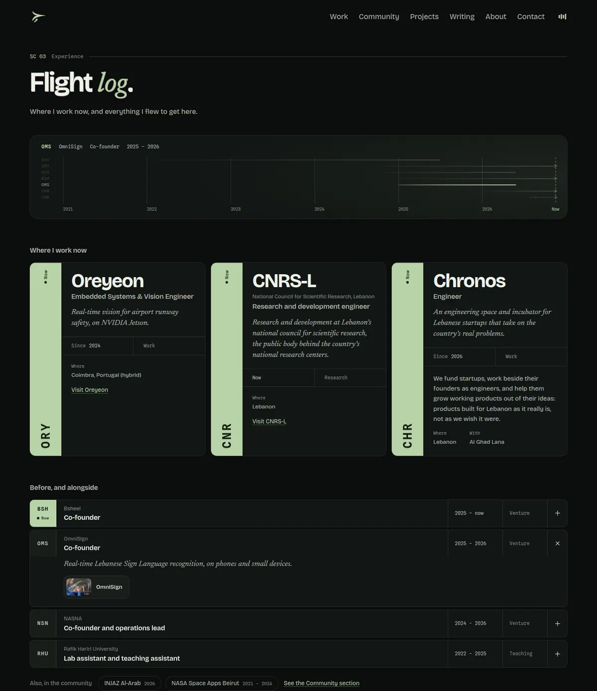

**The idea.** An air-traffic controller's strip board. Every role is a paper flight strip ruled into fields: a callsign block, the organization and role, the dates, the kind of work. Above the board, a timeline draws every role as a contrail, faint where it took off and bright at its nose; the roles still flying run into a "Now" line and blink there like transponders.

**Why it works.** It reads like a table (fast to skim) but has the texture of a real object from Rami's world (aviation, runway safety). The contrail chart makes concurrency visible: three jobs at once is obvious at a glance.

**Anatomy.** Contrail chart (callsign column + track; dashed when a start date is unknown; a dot for a one-day event) → "Where I work now": big strips with the callsign running vertically up the edge, the organization as the headline, the note set in the serif like a pencil mark → "Before, and alongside": compact strips that open → one community line.

**Motion and interaction.** On first sight the contrails draw in, in take-off order. Pointing at a contrail lights its strip and the readout line, and pointing at a strip lights its contrail. Clicking a contrail opens and scrolls to its strip. Strips open with a short reveal.

**Phone.** The chart compresses (smaller rows, every other year label); strips become callsign + role + dates, the kind column drops.

**Built with.** React, CSS grid, CSS transitions; no library.

**Code.** `src/components/vneo/experience.tsx`, `experience.css`.

**Reuse it for.** Any record with dates and states: a project log, a release history, a reading list ("reading / finished"), job applications in a tracker, maintenance logs, a lab's experiment register.

**Watch out.** Callsigns must be meaningful three-letter codes or they read as noise. Keep the strips' field widths fixed so columns align across rows.

**Status.** Backlog, kept for another section. Likely homes on this site: a project page's own build log (milestones as strips, the contrail as the project's timeline), or a release and changelog page for the site and its tools.

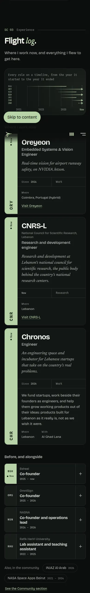

### v2 · Radar scope

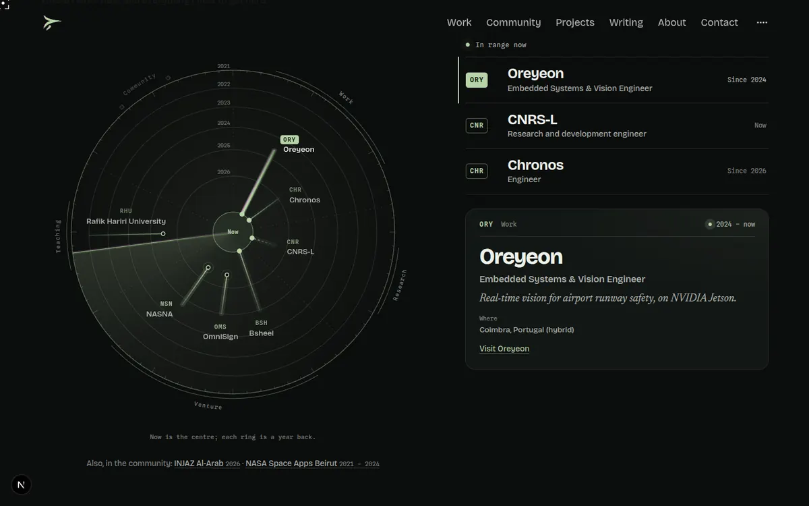

**The idea.** A ground-station radar. Now is the centre; each ring is a year back. Every role is a track on its own bearing, running from the year it started toward the year it ended, grouped into sectors by kind of work. A sweep turns once every five seconds and leaves a fading phosphor glow on each track it passes.

**Why it works.** Time becomes distance from the present, so what is current sits literally at the centre. It is the boldest of the five and unmistakably aviation, yet the list beside it keeps it readable.

**Anatomy.** The scope (rings labelled by year, sector arcs with curved labels, tracks with blips, faint diamonds outside the outer ring for community work) beside an "In range now" list of the current roles in big type, and a readout card for whichever role is selected.

**Motion and interaction.** On first sight the rings draw in and the sweep's first turn reveals the roles one by one. Hover, focus or tap a track or label to update the readout and dim the others; the list and the scope stay in sync. Rings are spaced to give recent years more room.

**Phone.** The scope fills the width with callsign-only labels; the list and card stack under it; tapping a role scrolls the card into view.

**Built with.** SVG and GSAP.

**Code.** `src/components/vneo/experience-v2.tsx`, `experience-v2.css`.

**Reuse it for.** Anything ranked by recency or distance: skills by when last used, a tech radar (adopt / trial / hold), sensors or devices in range, nearby events, a dashboard's "what changed recently".

**Watch out.** Old years crowd the outer rings; label sparingly. Don't encode anything on the angle that isn't real (sectors are categories, not values).

**Status.** Backlog, kept for another section; it lost to v3 because experience has to be read and the scope has to be decoded. Likely home: a skills and tools radar (adopt, trial, hold), a format people already know how to read.

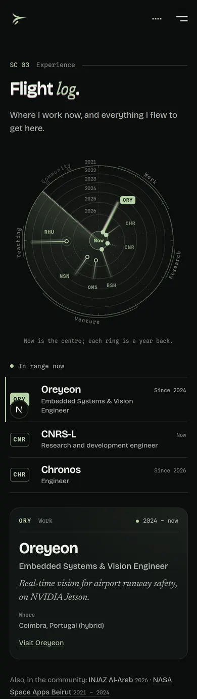

### v3 · Type-led index

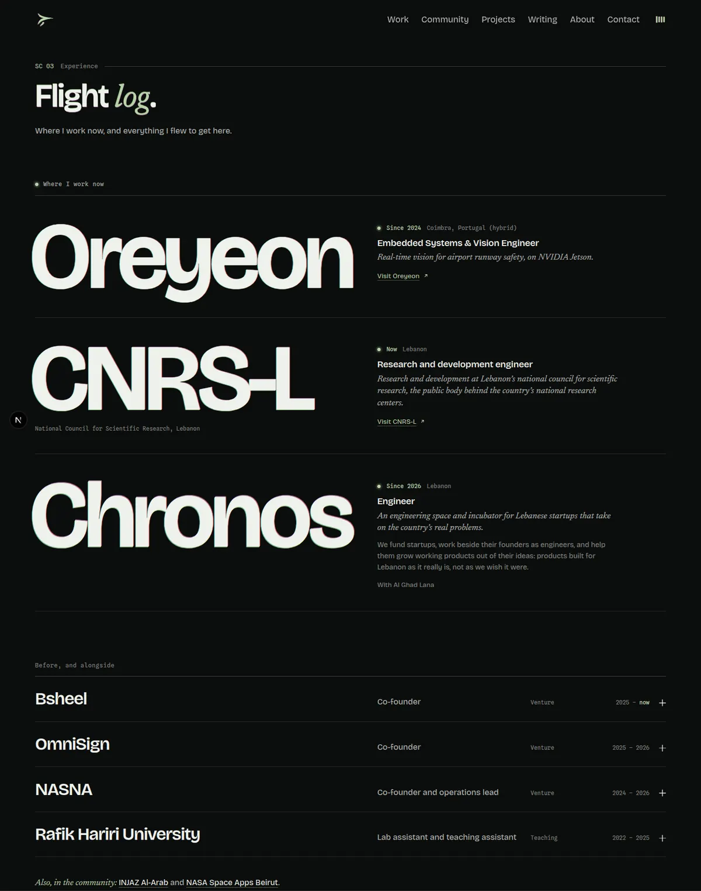

**The idea.** Editorial: typography is the design. The places Rami works now are set huge (about 13.5vw), each with a magazine caption: dates, place, role, the note in the serif, a link. Everything earlier is a quiet contents page on the same two columns. No cards, no boxes: whitespace, hairlines and type scale.

**Why it works.** Nothing says "this is where I work" faster than the name at poster size. It is calm, confident and fast to load, and it puts the employer's name (which carries weight) in front.

**Anatomy.** Big names with captions → hairline-ruled index rows (organization, role, kind, dates, a plus) → one community line.

**Motion and interaction.** Each big name comes into focus letter by letter (GSAP SplitText) and its fringe converges after the blur clears; pointing at one blurs the other two. Pointing at an index row floats a preview by the cursor (`gsap.quickTo`) that fringes when moved fast: the project's picture if it has one, otherwise its note. Rows open inline.

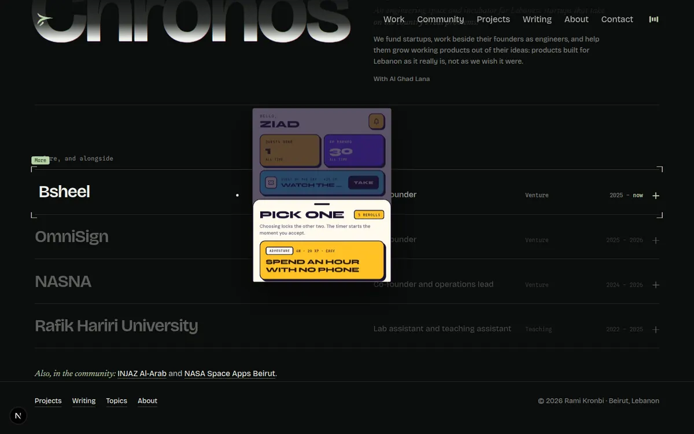

**Phone.** Names scale to about 23vw; no floating preview (touch), the opened row shows the thumbnail inline.

**Built with.** GSAP (SplitText, quickTo) and CSS.

**Code.** `src/components/vneo/experience-v3.tsx`, `experience-v3.css`.

**Reuse it for.** Clients and partners, publications, talks, a "selected work" list where names carry the weight, a portfolio index with hover previews.

**Watch out.** Long names break the scale (keep display names short, put long official names in the caption). Hover previews need a touch fallback.

**Status.** The live experience section since 2026-11-27. For now INJAZ and NASA Space Apps are full entries in its index rather than the community line, until Rami decides what stays.

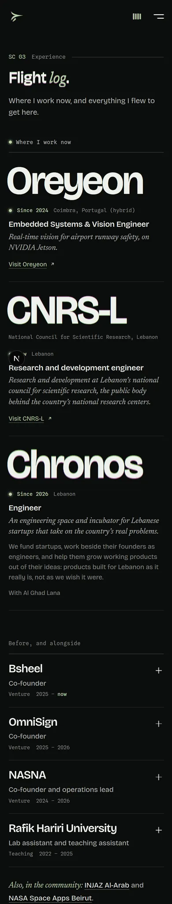

### v4 · Access passes

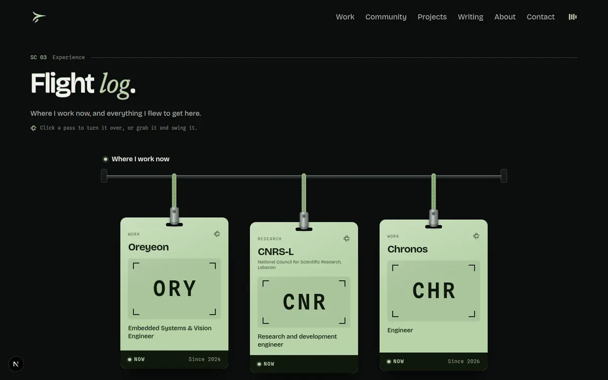

**The idea.** Each role is a staff access pass hanging from a lanyard on a rail, simulated with real physics. The callsign sits inside the site's ID-lock brackets where a photo would be; current roles hang first, larger, with a "Now" stripe. Click a pass to turn it over and read its back.

**Why it works.** It is tactile and memorable, the one people will play with, and the metaphor is exact: a pass is literally what you get when you work somewhere.

**Anatomy.** Two rails ("Where I work now", "Before, and alongside"); passes with kind, organization, callsign frame, role, dates; the back carries the note, detail, collaborators, project thumbnails and links. Community roles are tilted stickers linking to the community section.

**Motion and interaction.** On first sight the passes drop one by one, catch on slack lanyards and sway about once a bar. Brushing nudges a pass, grabbing swings it, and a drag never flips it. Passes don't collide, so dragging stays calm. Click, tap or Enter flips it with a 3D turn; on wide screens the turned pass comes toward you, larger, to be read. Escape turns it back. The simulation pauses off screen and re-hangs on resize.

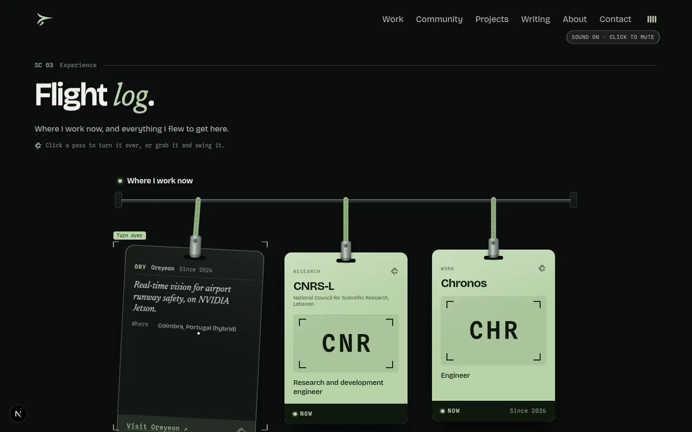

**Phone and reduced motion.** No physics: scroll-snap rows plus a chip index so all three current employers show at once.

**Built with.** matter-js (rope constraints, bodies mapped onto DOM transforms so text stays crisp) and GSAP for the flip.

**Code.** `src/components/vneo/experience-v4.tsx`, `experience-v4.css`.

**Reuse it for.** Team members, certifications and memberships, event badges, conference talks, access levels in an app, anything that is "a card you'd hold".

**Watch out.** Clean up the engine, runner and listeners on unmount; pause off screen. Separate drag from click with a movement threshold. Physics on phones is rarely worth it.

**Status.** Backlog, kept for another section. Likely homes on this site: the community section or the About page's talks and awards, where a pass or a badge is literally what you get at a hackathon, a conference or a competition (Space Apps, DevFest, INJAZ, WRO).

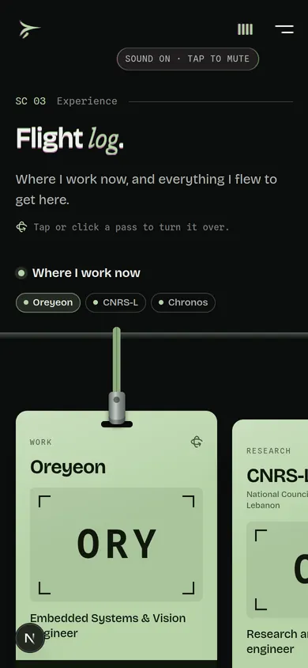

### v5 · Departures board

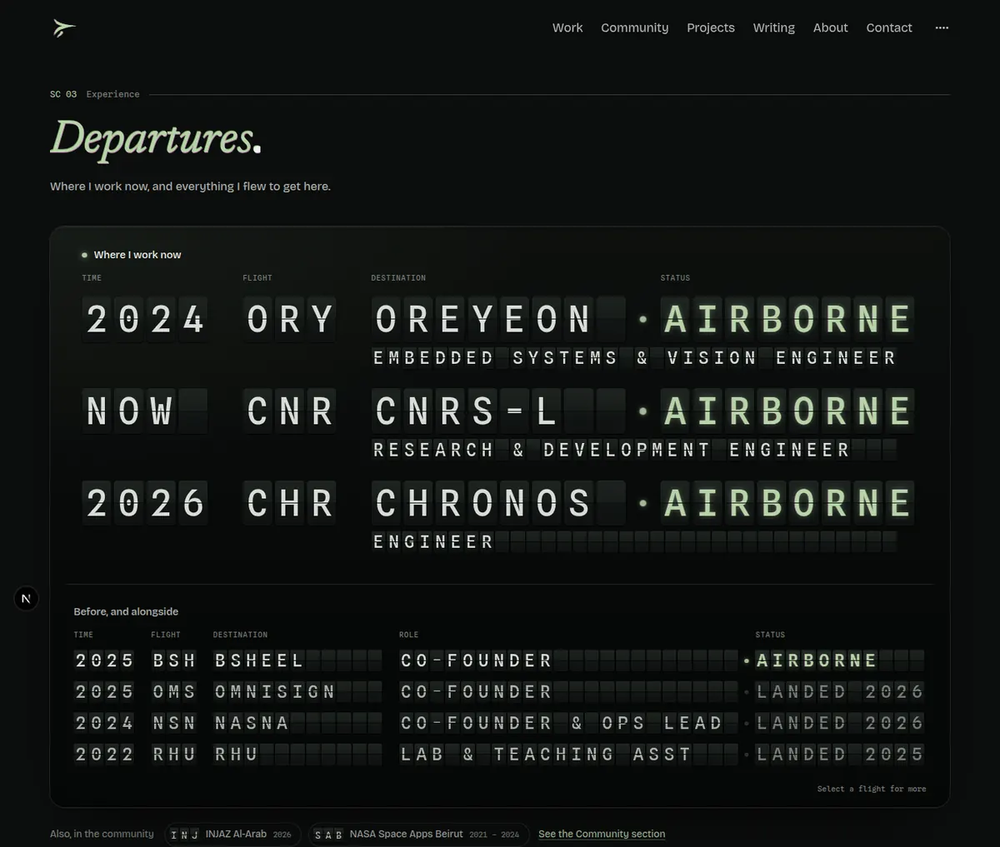

**The idea.** A terminal's split-flap departures board. Time (start year), flight (callsign), destination (organization), role and status. Current roles read "AIRBORNE" in lit Sage; past ones "LANDED 2026". The section title becomes "*Departures.*"

**Why it works.** Instantly recognisable, mechanical and satisfying, and still a table underneath, so it reads fast. The status column does the job of "where I work now" in one word.

**Anatomy.** A "Where I work now" panel of big tiles on top, the rest of the board under it, a hint line, a gate panel for the selected row, and community roles as tiny static tiles in one line.

**Motion and interaction.** On first sight every tile flips through characters and settles, one row every half beat. Each tile is a real two-half flap animated in 3D, not a text scramble. Hovering lights a row; click or Enter re-flips it and opens the gate panel (under the board on desktop, under the row on narrow screens). Escape closes it; arrow keys move between rows.

**Phone.** Fewer columns (flight, destination, status), with the role and dates under each row in normal type.

**Built with.** React, CSS 3D transforms, GSAP for the flip timing.

**Code.** `src/components/vneo/experience-v5.tsx`, `experience-v5.css`.

**Reuse it for.** Schedules and agendas (talks, workshops, a conference day), release trains, build or deploy status boards, "now playing" lists, any status-at-a-glance list.

**Watch out.** Fixed tile counts force abbreviations (here "RHU", "CO-FOUNDER & OPS LEAD"); the full text must live in the accessible label and the detail panel. Keep the tile count reasonable for performance.

**Status.** Backlog, kept for another section. Likely homes on this site: talks and workshops as a schedule (upcoming ones boarding, past ones landed), or the projects' status at a glance (shipped, in progress, retired).

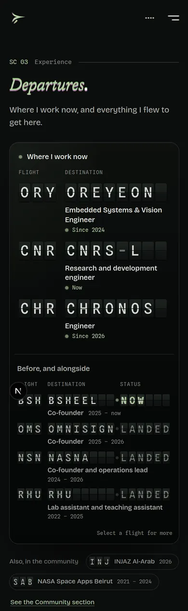

---

## Decluttering patterns

From the same day's pass over the projects section, which felt overwhelming.

**One lens for every picture.** Project pictures came from a dozen cameras: a blue workbench, a red thermal frame, white plots, a yellow app screen. They now rest as one duotone, black to Sage, and come back to colour while pointed at, focused or playing (on touch, while the card crosses the middle of the screen). Pictures on white sit on the page's dark instead of a white frame. Drawn scenes already in Sage are left alone. CSS only: `grayscale` + `contrast` + `brightness` on the image, a Sage layer with `mix-blend-mode: multiply` over it, removed on hover. In `src/components/vneo/vneo.css` ("One lens for every picture"). Works for any grid of mixed imagery: a blog index, a team page, a shop.

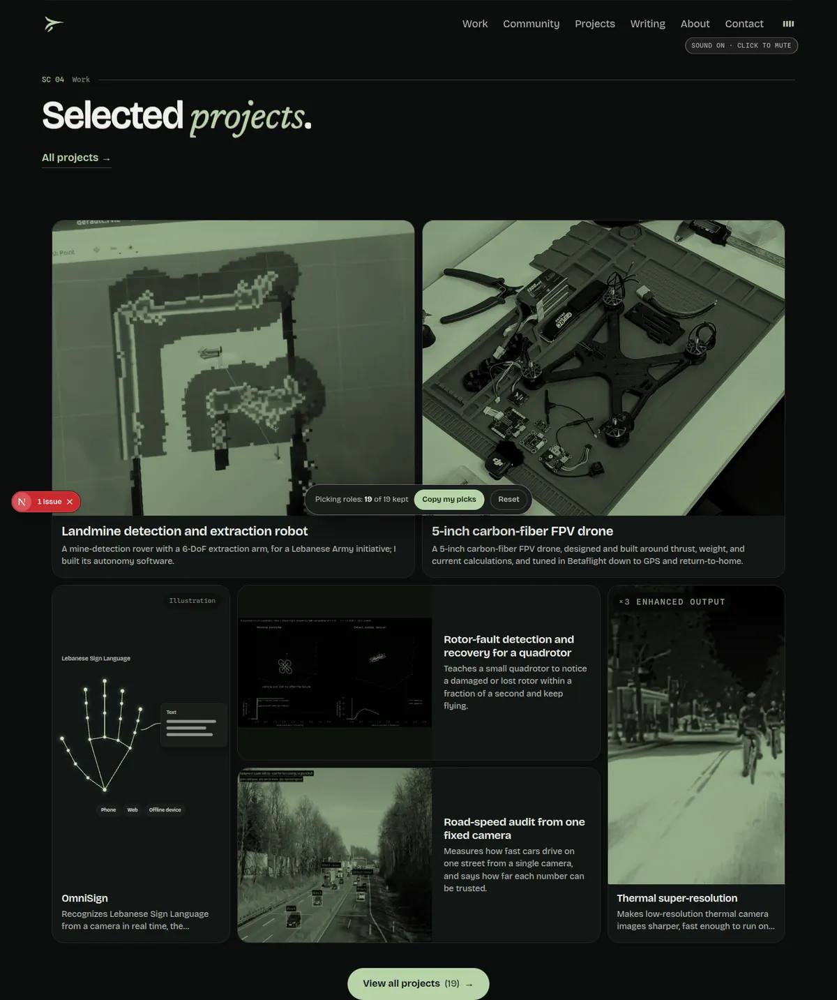

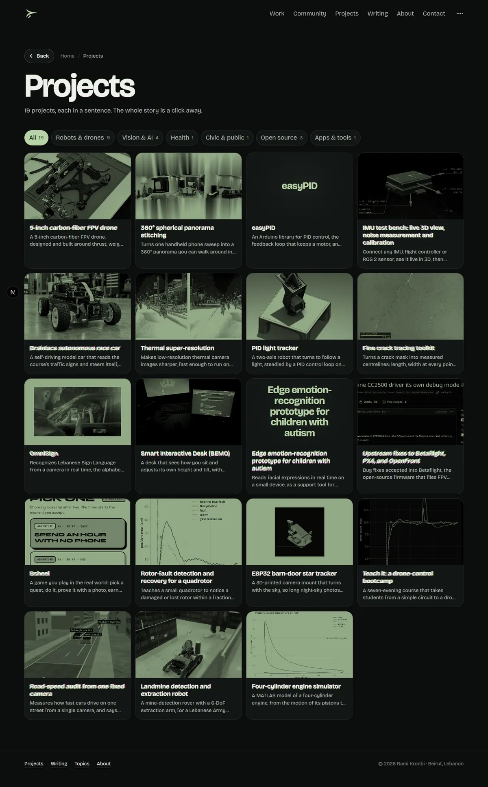

**Show six, link to all.** The home page shows the six most important projects in a fixed bento; everything else is on the projects page behind one "View all projects (19)" button.

**Bench, don't delete.** Tiles taken off the home grid keep their settings with `home: false`; roles off the board keep their records with `keep: false`. Bringing one back is a one-line change.

**A card says two things.** Name and one sentence. Category labels and result pills move to the project's own page.

**Don't say it twice.** A section that repeated another ("More of the work" repeated All projects) goes. Community work lives in the community section and gets one line elsewhere.

---

## Ways of working

**Let him decide by looking.** In development only, a picker on the real section: Keep/Drop on every item, a title switch where a title is undecided, a dock that counts the picks and copies them as plain text to paste back. Picks persist in `localStorage`; the shipped page never contains the picker (`process.env.NODE_ENV` guards it, and the bundler drops it). See the dock in `experience.tsx`.

**See production in development.** `?live` on the home page drops the picker and every dropped item, so the dev server shows exactly what will ship.

**Variants in place.** Build each option as its own component with the same props; a development-only switch (`?exp=v2`) swaps them on the real page, in context, between the real neighbours. Production imports only the chosen one: dynamic imports inside a `NODE_ENV === 'development'` branch never reach the production bundle (check with a build and a search of `.next/static`).

**Build options in parallel safely.** When several people or agents build variants at once, give each one its own files and its own temporary development-only route (`/lab/...`), so a half-finished variant cannot break the page the others are checking. Wire the shared switch only after all of them are done, then delete the temporary routes.

**Unsettled facts wait in review.** A record in `review` renders in development and in a preview built with `AUTHORITY_INCLUDE_REVIEW=1`, never in production; `hold` never renders. New roles, titles or dates go in as `review` until confirmed.

**Check in a real browser, headless.** Chrome through playwright-core with `--use-angle=swiftshader --enable-unsafe-swiftshader` for WebGL; WebKit for iPhones (Chrome's phone emulation is not enough). Screenshot desktop (1440 × 900) and phone (390 × 844), check `scrollWidth <= clientWidth`, collect page errors, and look at the pictures.

---

## Earlier ideas still in the code

The site went through several complete versions (October 2026) before settling on the current one. Their routes are gone, but much of their code is still in `src/components/v2` … `v7` and `vneo`, and several pieces run on the live site.

| Idea | What it is | Code | Where it runs |
| --- | --- | --- | --- |
| Lock-on cursor | Brackets spring out to frame anything actionable and name the action; the dot disperses into green and magenta when moved fast | `vneo/cursor.tsx` | every page |
| The page as a lens | Headings and photos fringe in proportion to their distance from the pointer; fast scrolling defocuses; holding the mouse pulls focus | `vneo/lens.tsx` | every page |
| Optic | Real chromatic aberration on a photo: drawn twice (magenta, green), screened together, slid apart by `--ca` | `v7/optic.tsx` | scenes, community plates |
| Slates | Film-slate section openers: scene number scrambles in, rule draws, title rises | `vneo/slate.tsx` | home sections |
| Specimen drone | The E58 in WebGL over a contour terrain; drag to tilt, a PD loop self-levels it with slight overshoot; motor bars from a quad-X mixer | `v2/home/specimen.tsx` | home hero |
| Every arrow is a tracker | A field of arrows, each a one-axis PD tracker turning toward the cursor; presets change the damping | `v2/home/light-field.tsx` | in code |
| Thermal drone | The drone through a thermal camera, heat as a model, tracking the cursor with the same PD law, with a detector box | `v3/home/thermal-drone.tsx` | in code |
| Flight track | A curve threads career waypoints and is flown as the page scrolls, a small quad on its leading edge | `v3/home/flight-log.tsx` | in code |
| What I build | One sentence, each phrase lit while pointed at, beside the portrait with the ID lock | `vneo/build.tsx` | home |
| Timeline scrubber | The page as a video timeline: chapters, playhead = scroll, timecode, jump to chapter | `v4/shell/timeline.tsx` | in code |
| Ground control | A single-screen station: procedural terrain drawn as an aeronautical chart, projects as airports, career as an RNAV route; webcam hand steering with no library | `v5/ground-control.tsx`, `terrain.ts`, `map-draw.ts`, `sense.ts` | in code |
| Reel shots | The ARMED showreel's 1920 × 1080 scenes ported as scroll-played shots, scaled with `tan(atan2(100cqw, 1920px))`, holding their last frame | `v6/shot.tsx`, `v6/armed.ts` | case pages, work grid |
| Square scenes | 1200 × 1200 explainer scenes played once at 96 BPM, held, with an ambient loop | `v7/scene.tsx` | community, work grid |
| Three machines, one loop | Sense–decide–act as a block diagram; a pulse runs the loop once per machine in its own footage, then the laps stack into a grid | `vneo/machines.tsx` | home |
| The closing quad | A 5-inch quad loses a rotor, the fault is caught, it holds its hover on three | `vneo/quad.tsx` | home |
| The robot pack | 36 simulated Go2s scanned, tracked, falling into ranks and walking into "RK." | `vneo/robots.tsx` | robotics topic |
| Rā' takes aim | The emblem acts out sense, decide, act: scan, choose an arc, fly it, become the mark | `vneo/aim.tsx` | About |
| Through the lens | Light splits green and magenta through a lens, closes into an achromat, the frame resolves, the tracker head follows | `vneo/light.tsx` | light-tracker project |
| Sign-off shader | The contact panel over a Sage dithering shader, warmed in idle time | `v2/home/sign-off.tsx` | home |
| Preflight intro | A once-per-visit loading screen: the throttle bar is the real model download, then arm, flip, lens dive, and the name glides onto the page heading; 3D in a Web Worker on an OffscreenCanvas | removed 2026-11-20; recover with `git show 69d2bb7:src/components/v2/intro/intro.tsx` (and `preflight.ts`, `preflight.worker.ts`, `intro.module.css`) | — |

---

## Hard-won lessons

- **GSAP slows its clock under load.** On a heavy page (WebGL hero, many shaders) its lag smoothing stretches entrance animations; in headless software rendering they can take several times longer. Judge timing on a real GPU.
- **A hidden browser tab never finishes streaming.** React reveals streamed Suspense sections on an animation frame; a hidden tab gets none, so sections stay in hidden holders. Verify in a visible or headless browser.
- **SVG filters stall frames.** A chromatic "ghost" as an SVG filter dropped frames; a CSS `drop-shadow` pair does the same job on the compositor.
- **Safari miscomputes `tan(atan2(100cqw, 1920px))`** without registered lengths; register `@property --frame-w/--frame-h` on the stage.
- **Scaling many SVG elements about their centre forces `getBBox`.** Animate `r` or opacity instead.
- **Synthetic `pointerenter` fires during scroll.** Check `movementX/Y` before treating it as intent.
- **A server component cannot read a registry exported from a `'use client'` module.** Keep registries in plain modules.
- **`:is()` cannot hold relative selectors.** `:is(> img)` is invalid and drops the whole rule; write `> :is(img, video)`.
- **Long WebGL work belongs off the main thread.** The intro rendered in a Web Worker on an OffscreenCanvas (Safari falls back to the page; GLTFLoader there needs a `new Image()` shim); the hero waited for it before building its own WebGL.
- **A drag is not a click.** Use a movement threshold before letting a pointer-up open or flip anything.
